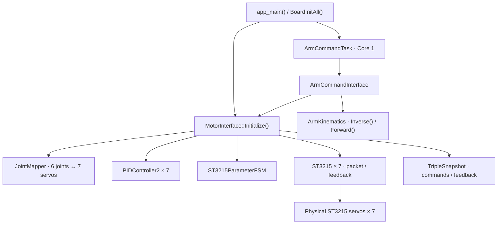
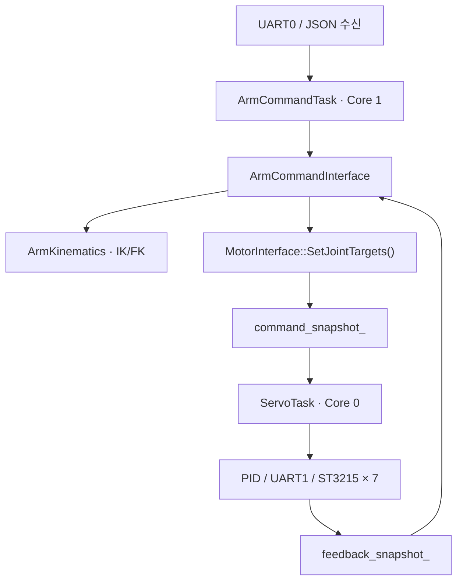

# RoArm-M3 ESP32 Custom Firmware

[](#development-status)

Waveshare **RoArm-M3**의 ESP32 제어 보드에서 동작하는 독립적인 **ESP-IDF / C++ 로봇팔 펌웨어** 개발 프로젝트입니다.

제조사 펌웨어 대신 직접 작성한 코드로 **6개 관절(7개 물리 서보)의 피드백 수집, 동기 출력, 제어 주기 및 오류 대응**을 관리하는 것이 목적입니다. 최종적으로는 Physical AI 시스템에서 로봇팔의 저수준 제어 인터페이스로 사용합니다.

## Target

- **Robot arm:** Waveshare RoArm-M3
- **Controller:** RoArm-M3 내장 ESP32 보드 (ESP32-WROOM-32 기반)
- **Actuators:** Feetech ST3215 계열 시리얼 서보 7개 (독립 관절 6축; Shoulder 구동/종동 2개)
- **Servo bus:** Half-duplex UART, 1 Mbps, 8N1 (현재 프로젝트 설정)
- **Firmware:** ESP-IDF v6.1, C++ / FreeRTOS
- **Build system:** ESP-IDF / CMake

서보 ID, 통신 설정 및 레지스터 동작은 실물 하드웨어에서 검증할 예정입니다.

## Development Goals

1. 제조사 제어 기능을 참고하여 독립 펌웨어로 로봇팔 구동 기반을 구현합니다.
2. 7개 서보를 일정 주기로 읽고 제어하며, **Read All → Compute All → Commit All** 형태의 다축 동기 제어를 목표로 합니다.
3. ST3215 내부 위치 제어에 전적으로 의존하지 않고, ESP32에서 피드백 기반 **외부 PID 및 관절 제어**를 구현할 계획입니다. PWM 직접 제어 모드의 실제 지원 범위는 검증이 필요합니다.
4. 통신 지연, 제어 주기, 다축 동기화, 오류 처리 및 정지 동작을 측정·개선합니다.
5. 초기 개발 목표는 제조사 펌웨어와 비교 가능한 기본 제어 기능과 응답성을 확보하는 것입니다. 성능 비교 목표(약 80%)는 개발 지향점이며, 달성 여부는 아직 검증되지 않았습니다.

## Physical AI Integration Plan

이 저장소의 ESP32 펌웨어는 **AI 추론 자체보다 로봇팔의 저수준 제어와 안전 처리**에 집중합니다.

```text
사용자: 작업 목표 지정 / 운용 승인 / 중지 판단
                 │
                 ▼
상위 Physical AI (향후 VLA/VLM 기반 인식·행동 판단)
                 │  목표 동작 / 관절 또는 동작 명령
                 ▼
Orange Pi 5+ / KCF 기반 애플리케이션 (계획)
  - 주행·로봇팔 Controller, Pre-Grasp/Grasp, Motion Planning
                 │  X/Y/Z/T/R/G 목표 Pose · 명령 / 피드백
                 ▼
RoArm-M3 ESP32 Custom Firmware
  - UART0 JSON · ArmKinematics IK/FK · JointMapper
  - 7개 서보 피드백 수집 / Snapshot
  - 외부 PID 연산 경로 (구현, 물리 동작 미검증)
  - 다축 출력 / 오류 처리 / 안전 제한 (개발 중)
                 │
                 ▼
           ST3215 서보 × 7
```

**판단과 제어의 역할**

- **사용자:** 수행할 작업과 목표를 지정하고, 운용 여부 및 중지·개입을 결정합니다.
- **상위 AI:** 향후 카메라·센서 정보를 활용해 물체 인식, 집기·놓기 등의 동작을 판단하고 구체적인 행동 명령을 생성하도록 계획합니다.
- **ESP32 펌웨어:** 상위 명령을 직접 검증·실행할 수 있는 하위 관절/모터 제어, 상태 피드백 및 오류 대응을 담당합니다. 안전 제한을 AI 판단에만 맡기지 않는 구조를 지향합니다.

현재 버전에는 AI 모델이나 상위 SBC Controller 연동 기능이 포함되어 있지 않습니다. ESP32는 X/Y/Z/T/R/G 목표 Pose의 IK/FK 및 저수준 모터 제어를 담당하고, 향후 Orange Pi 5+는 VLA/LLM, 이동·파지 계획, 주행·팔 Controller를 담당하는 구조를 목표로 합니다. ROS/ROS 2는 사용하지 않습니다.

## Architecture

### Class relationships (v0.16)



`ArmKinematics`와 `MotorInterface`는 상하 종속 관계가 아니라, 상위 `ArmCommandInterface`가 각각 호출하는 독립 모듈입니다. `JointMapper`는 `MotorInterface`에서 사용하는 정적 API이며, `PIDController2`와 `ST3215` 인스턴스는 각각 7개입니다. `ST3215ParameterFSM`은 초기 파라미터 검증 및 선택적 변경을 담당합니다.

### Command and feedback flow (v0.16)



**명령별 분기:** `T=1041`은 `ArmKinematics::Inverse()`로 Cartesian 목표를 관절각으로 바꾼 뒤 목표를 저장합니다. `T=102`는 직접 관절각을 검증해 저장합니다. `ArmCommandInterface::Process()`가 ARMED 상태에서 주기적으로 `SetJointTargets()`를 호출합니다. `T=105` 피드백 요청은 `MotorInterface::GetJointFeedback()`과 `ArmKinematics::Forward()`를 거쳐 JSON을 반환합니다. `T=0`은 목표 해제와 비동기 DISARM 요청이며, 하드웨어 비상 정지를 보장하지 않습니다.

두 Task는 함수 호출 체인 하나로 동작하는 것이 아니라, `command_snapshot_` / `feedback_snapshot_`을 통해 서로 다른 실행 문맥에서 데이터를 교환합니다.

### Communication and execution

| Context | Role | Configuration |
| --- | --- | --- |
| ArmCommandTask | UART0 console JSON input, target refresh, feedback request | Core 1, priority 3, 20 ms loop |
| ServoTask | Servo communication FSM, PID, UART1 | Core 0, priority 5, 1 ms task loop |
| Host JSON | One JSON object per line via configured UART0 console | GPIO1/3, 115200 baud (configuration-dependent) |
| Servo bus | Seven servos, sequential READ and conditional SYNC_WRITE | UART1 GPIO19/18, 1 Mbps |

현재 UART0 표준 입력은 ESP-IDF 기본 비블로킹 콘솔 VFS 설정을 전제로 합니다. 실제 JSON 송수신은 아직 보드에서 검증되지 않았으며, 진단 로그와 JSON 응답이 같은 콘솔에 섞일 수 있습니다. 이동 보간 및 속도·가속도 제어는 미구현입니다.

### Supported JSON commands (software implementation)

```json
{"T":102,"base":0,"shoulder":0,"elbow":1.57,"wrist":0,"roll":0,"hand":3.14}
```

```json
{"T":1041,"x":235,"y":0,"z":234,"t":0,"r":0,"g":3.14}
```

```json
{"T":105}
```

```json
{"T":0}
```

`T=102` (관절각), `T=1041` (목표 Pose), `T=105` (FK 기반 피드백), `T=0` (비동기 DISARM 요청)을 처리합니다. 속도/가속도 옵션 `spd`, `acc`의 0이 아닌 값은 지원하지 않습니다. `T=105` 응답은 제조사 전체 포맷이 아닌 최소 커스텀 JSON입니다. JSON 명령을 한 번 수신한 목표는 내부에서 반복 발행하며, **명령 만료 및 통신 두절 안전 정책은 아직 미구현**입니다.

## Development Status

**v0.16 — IK/FK, JSON command interface and Application Task (build PASS; hardware test pending)**

| Area | Status |
| --- | --- |
| JointMapper (6 관절 ↔ 7 서보) | v0.15 소스 구현, 빌드 PASS |
| ArmKinematics IK/FK | v0.16 구현, 빌드 PASS; 전체 작업 공간 실기 검증 전 |
| ArmCommandInterface 및 JSON 명령 | v0.16 구현, 빌드 PASS; 실제 UART 송수신 미검증 |
| ArmCommandTask · Core 1 | v0.16 연결, 빌드 PASS; 실제 Task 실행 미검증 |
| ESP-IDF 프로젝트, UART 보드 초기화, ServoTask 시작 | 소스 구현 |
| ST3215 패킷 생성·응답 파싱 및 7개 서보 피드백 수집 | 소스 구현 |
| 7개 ID (11~17) 순차 INIT 모드 검증 후 READY | 소스 구현 |
| EEPROM 모드 변경 (Unlock → WRITE → READ BACK → Lock) | 구현, 기본 실행 금지 |
| 기본 초기화 모드 정책 | EEPROM WRITE 0, 현재 PWM_OPEN 모드 READ 검증 |
| 토크 제한 설정 | 구현, 초기화 자동 WRITE 기본 비활성화 |
| Command Snapshot → 7개 서보 SYNC_WRITE | 코드 경로 구현, PWM 출력 비활성화 |
| 외부 PID 계산 (PIDController2 × 7) | 구현, 게인 0 기본값 / 물리 출력 비활성화 |
| ChangeState/EnterState/ExitState (interface / comm) | 구현, 전환 시에만 훅 실행 |
| HOME/IDLE, 하드웨어 긴급 정지 | 미구현 (T=0은 DISARM 요청만 수행) |
| ESP-IDF v6.1 빌드 / 실물 서보 검증 | v0.16 빌드 PASS (개발자 확인) / 실물 미검증 |

기본값에서는 현재 모드가 목표 PWM_OPEN과 다르면 INIT이 실패하며, **EEPROM을 자동 변경하지 않습니다.** 토크 활성화 및 PWM 출력도 자동 실행하지 않습니다. 실물 구동 전에는 토크 해제 시 중력 낙하 위험, 직접 PWM 제어 적합성, 통신·정지 안전 조건을 별도로 확인해야 합니다.

## Project Layout

```text
main/
├── main.cpp                # app_main, ArmCommandTask and UART0 JSON dispatch
├── arm_command_interface.* # JSON parse, IK/FK calls, target refresh, feedback
├── arm_kinematics.*        # Cartesian Pose ↔ JointAngles
├── joint_mapper.*          # JointAngles[6] ↔ ServoPositions[7]
├── motor_interface.*       # seven-servo FSM, ServoTask, snapshots, PID
├── pid.h                   # PIDController2
├── st3215.*                # servo serial protocol and feedback
├── st3215_parameter_fsm.*  # mode, torque and parameter transactions
├── gpio_config.*           # UART board initialization
├── pins.h                  # board UART/GPIO definitions
├── shared_snapshot.h       # triple snapshot utilities
├── test_arm_kinematics.cpp # test source, excluded from firmware build
└── idf_component.yml       # espressif/cjson dependency
```

## Build

ESP-IDF 환경을 활성화한 뒤 프로젝트 루트에서:

```bash
idf.py set-target esp32
idf.py build
```

v0.16은 개발자 환경의 ESP-IDF v6.1에서 빌드 PASS로 보고되었습니다. 플래시, JSON 실통신, IK/FK 실기 정확성 및 실제 모터 동작은 별도로 검증해야 합니다.

개발 내역과 이후 변경 계획은 [update.md](update.md)를 참고하세요.


### Servo ARM/DISARM FSM (v0.14)

- Integrated `DISARMED, ARMING, ARMED, DISARMING` into the existing `MotorInterfaceState`; no separate servo-control FSM. Existing ChangeState/EnterState/ExitState hooks are retained.
- READY first READ-verifies Torque Enable=OFF on all seven servos, then enters DISARMED. A servo that is initially ON causes ERROR rather than automatically disabling torque and risking gravitational fall.
- DISARMED continues sequential feedback READ. Only ARMED can compute PID and pass the PWM transmit gate. ARMING/DISARMING stop normal communication and own the single UART through `ST3215ParameterFSM` Torque Enable WRITE + READ BACK per servo.
- `RequestServoOn()`, `RequestServoOff()` use atomic requests; ARM preconditions include current valid command/feedback. No automatic ARM at boot.
- **Safety defaults:** `MOTOR_TORQUE_WRITE_ENABLE=0`, `MOTOR_PWM_OUTPUT_ENABLE=0`, `MOTOR_EEPROM_WRITE_ENABLE=0`. ARM requests are rejected until hardware safety is validated.
- Partial torque activation may persist on ERROR; a physically tested safe-stop/rollback and gravity-safe support remain required before enabling torque writes.


## POSITION ARM dry-run safety check

In the current **POSITION** build, the physical torque and position output
compile guards remain disabled. Nothing in these diagnostic commands enables
a motor. Keep `MOTOR_TORQUE_WRITE_ENABLE=0` and
`MOTOR_POSITION_OUTPUT_ENABLE=0`.

- `{"T":211}`: display DISARMED state, feedback validity and output gates
- `{"T":212}`: read current seven encoder positions (hold candidate)
- `{"T":213}`: read-only ARM preview. Requires DISARMED, fresh feedback,
  position range 0–4095 and absolute reported servo velocity <= 50.
  Returns `dry_run:true` and prospective hold encoder positions, never
  publishes an output command or turns on torque.

`T=213` does **not** prove that physical ARM is safe: the servo may move
between the snapshot and torque enable; the manufacturer-specific
position/time/speed/acceleration format, safe first write, command handoff,
gravity support, partial torque-on rollback and motion limits are still
unverified. The compile-time guard intentionally prevents enabling physical
POSITION torque or output until these are designed and tested.

Previously observed sequential seven-servo feedback takes about 7.1 ms;
the 5 ms transmit-cycle budget is insufficient for physical output and
must be independently validated before enabling motion.
